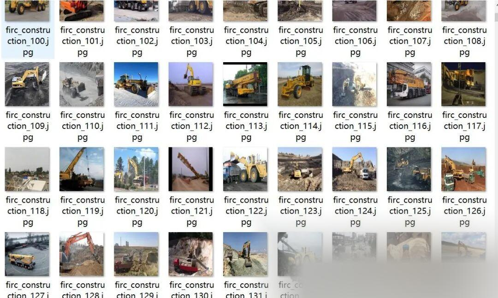
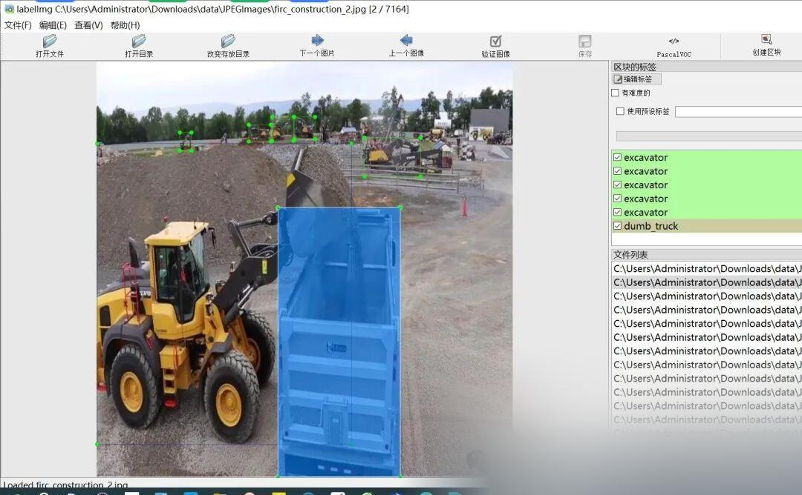

# Intelligent Construction Site Safety Automated Monitoring and Testing Data Set - VOC+YOLO Format - 7164 Images in 10 Categories

Dataset format: Pascal VOC format + YOLO format (txt file without split path, only containing jpg images and corresponding VOC format xml files and yolo format txt files)

Number of images (number of jpg files): 7164

Number of annotations (number of xml files): 7164

Number of annotations (number of txt files): 7164

Label category count: 10

Label category names (note that the order of categories in the YOLO format does not correspond to this, but is based on the labels folder's classes.txt): ["bull_dozer", "dumb_truck", "excavator", "grader", "loader", "mobile_crane", "reflective_vest", "roller", "safety_helmet", "worker"]

Number of boxes labeled in each category:

Bulldozer frame count = 1339

dumb_truck frame count = 2626

Excavator frame count = 2046

Grader Frame Count = 1145

Loader frame count = 641

mobile_crane Frames = 766

reflective_vest frame count = 430

Number of rollers = 1138

safety_helmet Frame Count = 1773

Worker frame count = 2790

Total frame count: 14694

Using labelImg:

Annotation rules: Draw a rectangle around the category.

Important Notice: No

Special : This dataset does not guarantee the accuracy or precision of the trained models or weight files. The dataset is provided with accurate and reasonable annotations only.

Image Preview:

Annotation example:

## Payment

Here is a pay link on Stripe ( https://buy.stripe.com/3cs8yP7sY87d0vu9AB ). Please contact me lonlonago@foxmail.com after funding $89, and I will send you a complete data files , thank you!

